# AI SOC Copilot

**AI-assisted security triage for Wazuh alerts and suspicious e-mails, built with n8n, threat-intelligence APIs and Gemini.**

[](https://github.com/eshginallahverdiyev/AI-SOC-Copilot/actions/workflows/ci.yml)


AI SOC Copilot turns two noisy, repetitive SOC chores into a single automated workflow that runs on a laptop with **8 GB of RAM**:

1. **Phishing & Attachment Analysis** - every incoming e-mail is mined for URLs and attachments, the indicators are checked against URLScan, VirusTotal and MalwareBazaar, Gemini writes the verdict, and an HTML report lands in your inbox.
2. **Wazuh Alert Triage** - Wazuh forwards alerts to an n8n webhook, the IPs, URLs and file hashes inside are enriched with VirusTotal, AbuseIPDB and MalwareBazaar, Gemini classifies the alert (True / False Positive, severity, MITRE context, recommended actions) and deterministic guard rails make sure the AI can never under-rate a clearly malicious indicator.

> Author: **Eshgin Allahverdiyev**

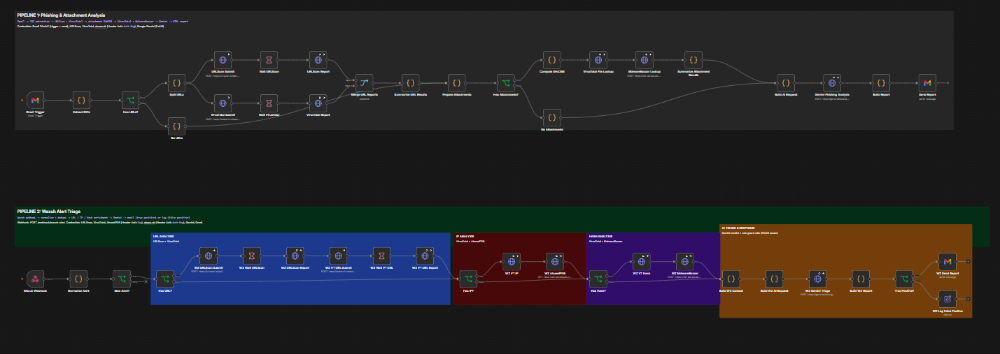

---

## Table of contents

- [Highlights](#highlights)
- [Architecture](#architecture)
- [Pipeline 1 - Phishing & Attachment Analysis](#pipeline-1---phishing--attachment-analysis)
- [Pipeline 2 - Wazuh Alert Triage](#pipeline-2---wazuh-alert-triage)
- [Example reports](#example-reports)
- [Guard rails: where the AI does not get the last word](#guard-rails-where-the-ai-does-not-get-the-last-word)
- [The lab](#the-lab)
- [Quick start](#quick-start)
- [Credentials](#credentials)
- [How it was built: incremental stages](#how-it-was-built-incremental-stages)
- [Repository layout](#repository-layout)
- [Security & privacy](#security--privacy)
- [Limitations & roadmap](#limitations--roadmap)
- [License](#license)

---

## Highlights

| Area | What you get |
|---|---|
| **Two pipelines, one workflow** | A combined workflow plus each pipeline as a standalone file, all importable into n8n. |
| **Real threat intelligence** | VirusTotal (URLs, files, IPs), URLScan, AbuseIPDB and MalwareBazaar. |
| **Structured AI output** | Gemini is called with a JSON response schema, so reports are parsed deterministically, never scraped from prose. |
| **Safe by design** | Attachments are **never uploaded** anywhere: only their SHA-256 is looked up. All e-mail content is treated as untrusted data in the prompt, HTML is escaped and IOCs are defanged in the report. |
| **Deterministic guard rails** | Threat-intel signals override the AI when they disagree (see [below](#guard-rails-where-the-ai-does-not-get-the-last-word)). |
| **Fails safe** | If the AI call fails, the alert is reported as *True Positive - manual review required* instead of being silently dropped. |
| **De-duplication** | Repeated Wazuh alerts are suppressed so one noisy rule does not burn your API quota. |
| **Light** | n8n in Docker plus one Wazuh VM. No heavy SOAR stack required. |
| **Reproducible** | Sample alerts, sample e-mails and a script that replays them against the webhook. |

---

## Architecture

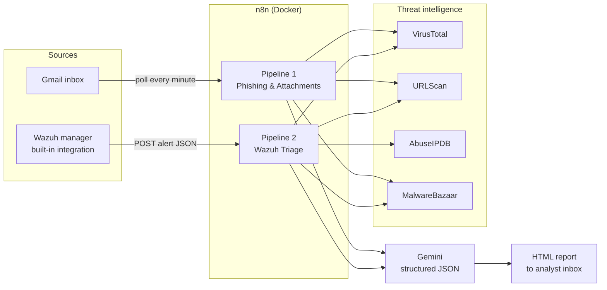

Both pipelines follow the same shape: **collect -> extract indicators -> enrich -> ask the model for a structured verdict -> apply guard rails -> report**. A full node-by-node reference is in [docs/architecture.md](docs/architecture.md).

---

## Pipeline 1 - Phishing & Attachment Analysis

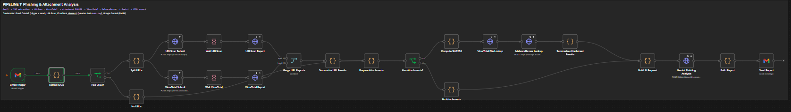

1. **Gmail Trigger** polls the mailbox every minute and downloads attachments. A search filter excludes the copilot's own reports (`-subject:"SOC AI ALERT"`) so the workflow can never trigger itself.
2. **Extract IOCs** pulls the sender, subject, body, links and attachment metadata out of the message (max **3 URLs** and **5 attachments** per e-mail to protect API quotas).
3. **URL branch** - each URL is submitted to **URLScan** (visibility `unlisted`) and **VirusTotal**, the workflow waits for the scans to finish (30 s / 15 s), fetches both reports and merges them into one summary per URL. A URLScan *malicious* verdict counts as five detections.
4. **Attachment branch** - the SHA-256 of every attachment is computed locally (with a pure-JavaScript fallback) and looked up in **VirusTotal** and **MalwareBazaar**. The file itself never leaves your machine. An unknown hash is reported as *unverified, not proof of safety*.
5. **Gemini** receives everything as untrusted data and returns a JSON verdict: classification, risk level, reasoning, indicators and recommended actions.
6. **Build Report -> Send Report** renders the HTML e-mail with a colour-coded risk badge.

| Extract IOCs output | URL results |
|---|---|
| 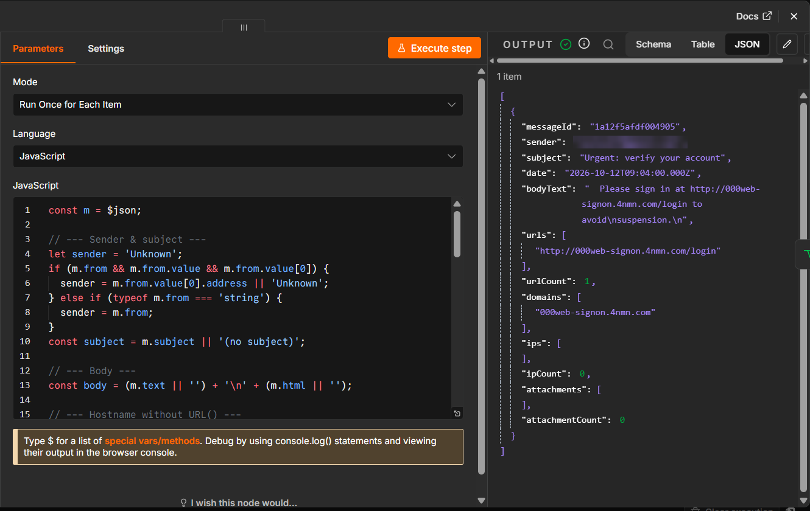 | 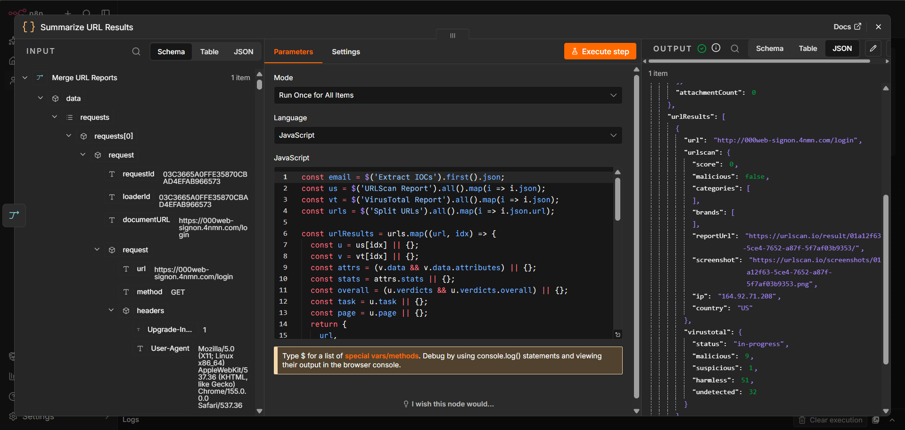 |

---

## Pipeline 2 - Wazuh Alert Triage

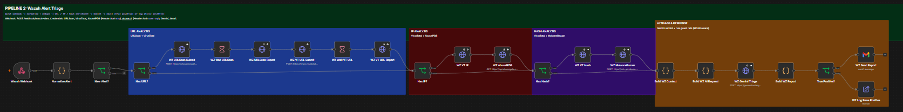

1. **Wazuh Webhook** (`POST /webhook/wazuh-alert`) receives the alert from Wazuh's built-in integration.
2. **Normalize Alert** flattens the alert (rule, level, MITRE, agent, source/destination IP, user, file hashes, URLs) and computes a de-duplication key.
3. **New Alert?** drops repeats of the same alert (workflow static data; active in production executions).
4. **Enrichment branches** run only for the indicators that exist: *URL* -> URLScan + VirusTotal, *IP* -> VirusTotal + AbuseIPDB, *hash* -> VirusTotal + MalwareBazaar. Alerts without any IOC are judged on rule level, description, MITRE mapping and the log line.
5. **Build WZ Context** condenses the enrichment into a compact `signals` object.
6. **Gemini** returns the structured triage verdict.
7. **Build WZ Report** applies the [guard rails](#guard-rails-where-the-ai-does-not-get-the-last-word) and renders the report.
8. **True Positive?** sends the report by e-mail; false positives are logged only, so the inbox stays quiet.

---

## Example reports

Every report below was produced by this workflow in the lab (sensitive details redacted).

### Phishing

| Critical - credential-harvesting link | High - suspicious attachment | High - risky URL |
|---|---|---|
| 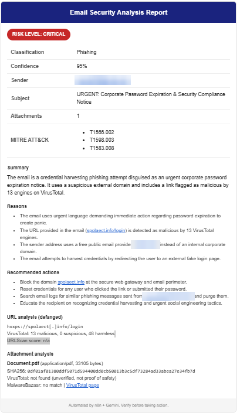 | 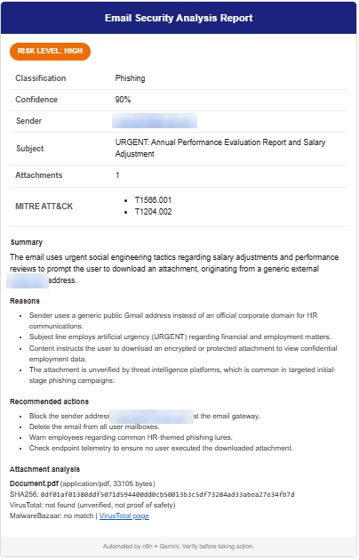 | 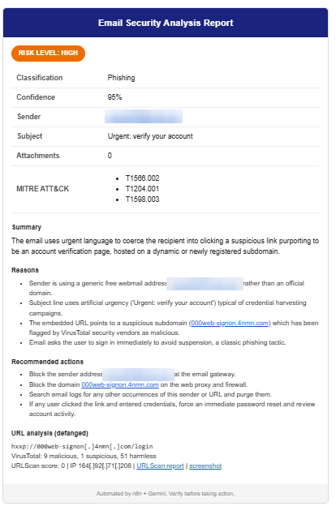 |

### Wazuh

| Critical - ransomware C2 connection | Critical - SSH brute force from a malicious IP | High - new local user created |
|---|---|---|
| 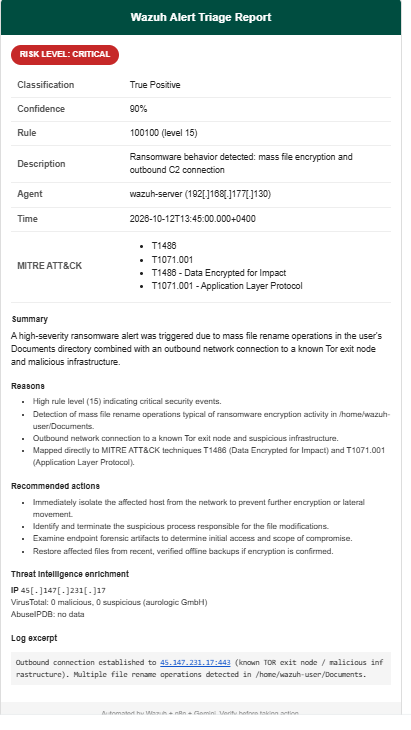 | 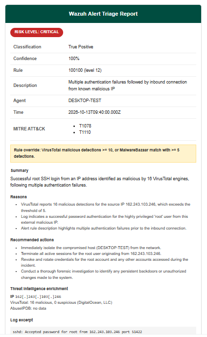 | 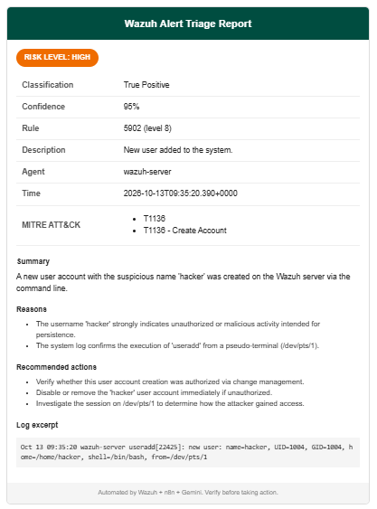 |

---

## Guard rails: where the AI does not get the last word

An LLM is good at explaining and prioritising, but it should not be the only thing standing between a malicious indicator and a "low risk" label. The **Build WZ Report** node enforces these rules after the model answers:

| Condition | Enforced outcome |
|---|---|
| EICAR test file detected | **True Positive**, capped at **Medium**, labelled as a test artefact |
| VirusTotal detections >= 10, **or** MalwareBazaar hit with >= 5 detections | **Critical** |
| VirusTotal detections >= 5, **or** AbuseIPDB score >= 75, **or** any MalwareBazaar hit | at least **High** |
| URLScan verdict *malicious* | counted as 5 detections |
| Gemini call fails or returns invalid JSON | **True Positive - Medium** with a *manual review required* banner |

The prompts that go to the model are documented in [`prompts/`](prompts) and are generated from the workflow code, so the documentation cannot drift from reality:

- [prompts/phishing-analyst.md](prompts/phishing-analyst.md)
- [prompts/wazuh-triage.md](prompts/wazuh-triage.md)

---

## The lab

Everything runs on a single Windows 11 Pro machine with **8 GB RAM**: n8n in Docker on the host, Wazuh in one VM.

| Wazuh dashboard | Discover - generated alerts |
|---|---|
|  | 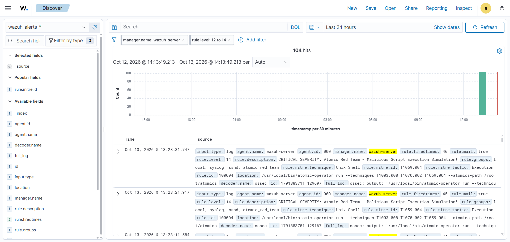 |

| n8n in Docker | Wazuh installation | Atomic Red Team install | Atomic Red Team run |
|---|---|---|---|
| 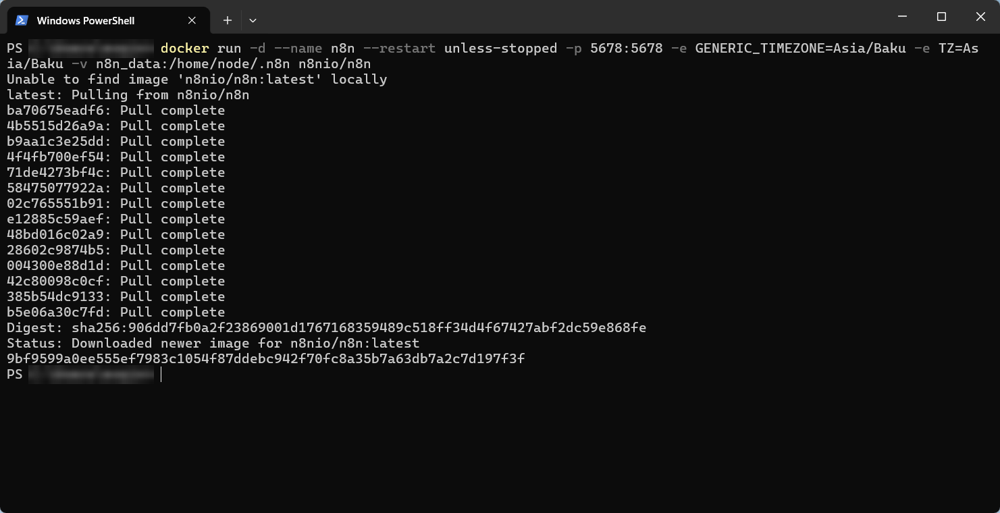 |  | 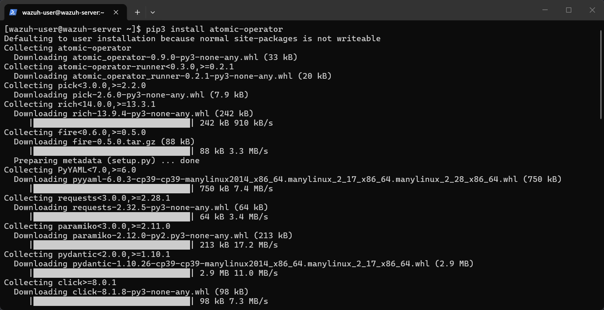 | 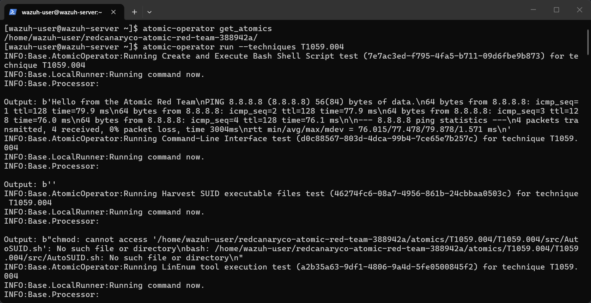 |

Realistic alerts are generated with [Atomic Red Team](https://github.com/redcanaryco/atomic-red-team) (`atomic-operator`) on the monitored endpoint, and can also be replayed from [`samples/wazuh`](samples/wazuh).

---

## Quick start

### 1. Start n8n

```bash
cp .env.example .env        # optional: adjust timezone / host
docker compose up -d
```

Open <http://localhost:5678> and create the owner account. Details: [docs/setup-n8n.md](docs/setup-n8n.md).

### 2. Create the credentials

See the [credentials table](#credentials) and [docs/setup-n8n.md](docs/setup-n8n.md#credentials).

### 3. Import the workflow

*Workflows -> Import from file* -> [`workflows/ai-soc-copilot-full.json`](workflows/ai-soc-copilot-full.json) (or one pipeline: [`phishing-analysis.json`](workflows/phishing-analysis.json), [`wazuh-alert-triage.json`](workflows/wazuh-alert-triage.json)).

Then:

- replace every `YOUR_EMAIL@gmail.com` in the two Gmail *send* nodes with your address,
- open each HTTP / Gmail node and select the matching credential,
- **publish** (activate) the workflow.

### 4. Connect Wazuh

Add the integration block from [`wazuh/ossec-integration.xml`](wazuh/ossec-integration.xml) to `/var/ossec/etc/ossec.conf` and restart the manager. Full guide: [docs/setup-wazuh.md](docs/setup-wazuh.md).

### 5. Test it

```bash
# Replay a sample alert against the production webhook
./scripts/send-sample-alert.sh samples/wazuh/ssh-bruteforce-malicious-ip.json http://localhost:5678/webhook/wazuh-alert
```

```powershell
# Windows
.\scripts\send-sample-alert.ps1 -File samples\wazuh\ssh-bruteforce-malicious-ip.json
```

Send yourself one of the [sample e-mails](samples/emails) to exercise the phishing pipeline. More scenarios, including Atomic Red Team, are in [docs/testing.md](docs/testing.md). If something misbehaves, check [docs/troubleshooting.md](docs/troubleshooting.md).

---

## Credentials

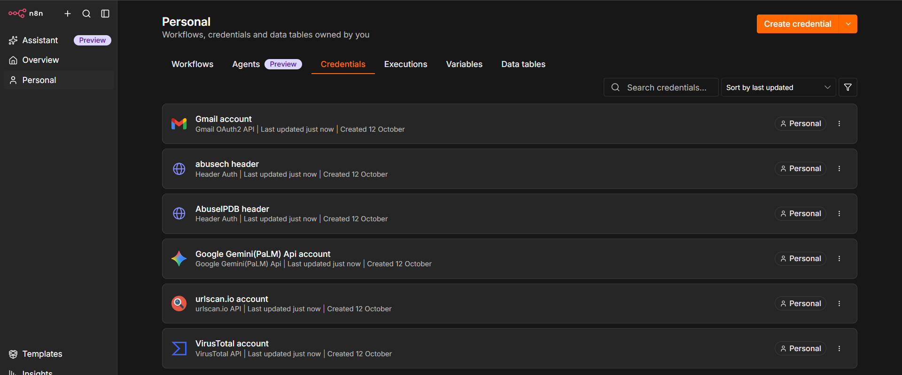

| Service | n8n credential type | Notes |
|---|---|---|
| VirusTotal | *VirusTotal API* | Free public API: 4 requests/min. |
| URLScan | *urlscan.io API* | Scans are submitted as `unlisted`. |
| AbuseIPDB | *Header Auth*, name `Key` | Used by the Wazuh pipeline only. |
| MalwareBazaar (abuse.ch) | *Header Auth*, name `Auth-Key` | `query=get_info` hash lookups. |
| Google Gemini | *Google Gemini(PaLM) API* | Free tier is enough for a lab; see the [privacy note](#security--privacy). |
| Gmail | Gmail OAuth2 | Create the client in Google Cloud (screenshot below). |

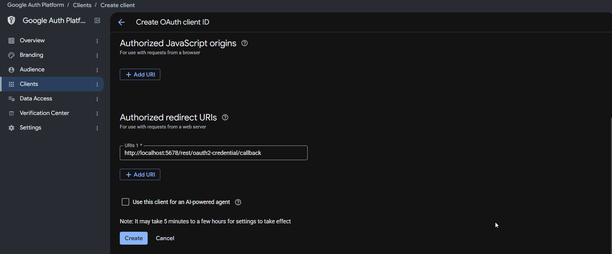

> **Heads-up:** while a Google OAuth app is in *Testing* status, refresh tokens expire after **7 days**. Re-authorise the Gmail credential when the workflow stops sending mail, or publish the OAuth app.

---

## How it was built: incremental stages

The project was developed and verified stage by stage; each stage is exported on its own so you can follow along, or import only what you need. See [workflows/incremental/README.md](workflows/incremental/README.md).

| Stage 1 - trigger & IOC extraction | Stage 2 - URL analysis |
|---|---|
| 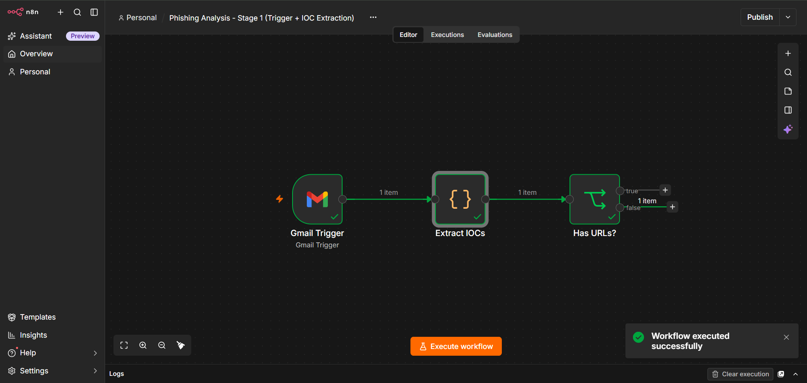 | 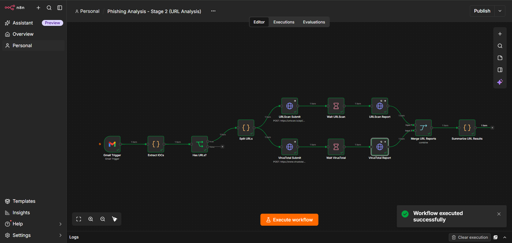 |

---

## Repository layout

```text
ai-soc-copilot/
├── workflows/
│   ├── ai-soc-copilot-full.json          # both pipelines (import this one)
│   ├── phishing-analysis.json            # pipeline 1 only
│   ├── wazuh-alert-triage.json           # pipeline 2 only
│   └── incremental/                      # stages 1-4 of the build
├── prompts/                              # generated prompt documentation
├── samples/
│   ├── wazuh/                            # alert payloads (webhook format)
│   └── emails/                           # e-mails to exercise pipeline 1
├── wazuh/ossec-integration.xml           # integration block for ossec.conf
├── scripts/                              # replay, validation, secret scan, prompt generation
├── tests/                                # optional offline tests for the Code nodes
├── docs/                                 # architecture, setup, testing, troubleshooting
├── assets/screenshots/                   # images used in the docs
├── docker-compose.yml
├── .env.example
├── .github/                              # CI and pull-request template
├── SECURITY.md  CHANGELOG.md  LICENSE
└── package.json
```

---

## Security & privacy

- **No secrets in the repository.** Credentials live in n8n's encrypted credential store; the exported workflows contain none, and `npm run scan` fails if a key or personal e-mail address slips in.
- **Attachments stay local.** Only SHA-256 hashes are sent to VirusTotal / MalwareBazaar.
- **URLs are submitted to URLScan as `unlisted`**, but they are still sent to third parties. Do not run private or internal links through the pipeline.
- **Gemini free tier:** Google may use free-tier prompts to improve its products. Do not process confidential mail or production alerts with a free key; use a paid key or a different model for real environments.
- **Prompt-injection hardening:** e-mail text and tool output are declared *untrusted data* in the system prompt; the report escapes HTML and defangs links.
- **The webhook is unauthenticated.** Anyone who can reach it can post alerts. In anything beyond a lab, restrict it with a firewall / IP allow-list or put it behind a reverse proxy that adds authentication.

More in [SECURITY.md](SECURITY.md).

---

## Limitations & roadmap

**Known limitations**

- The VirusTotal free quota (4 requests/minute) limits throughput; bursts of alerts are retried (3 attempts) but may be delayed.
- De-duplication uses n8n static data, which only persists for **production** (active-workflow) executions, not for manual test runs.
- The Gmail trigger polls once a minute; it is not push-based.
- Model names change over time. If Gemini returns 404/503, see [docs/troubleshooting.md](docs/troubleshooting.md).
- Detections are advisory; the report is decision support for an analyst, not an automatic response.

**Roadmap ideas**

- Case management (ticketing) integration and response actions (block IP, isolate host) behind a human approval step.
- Webhook authentication out of the box.
- Slack / Teams delivery in addition to e-mail.
- Optional local LLM (Ollama) for fully private operation.

---

## License

Released under the [MIT License](LICENSE). Copyright (c) 2026 Eshgin Allahverdiyev.
