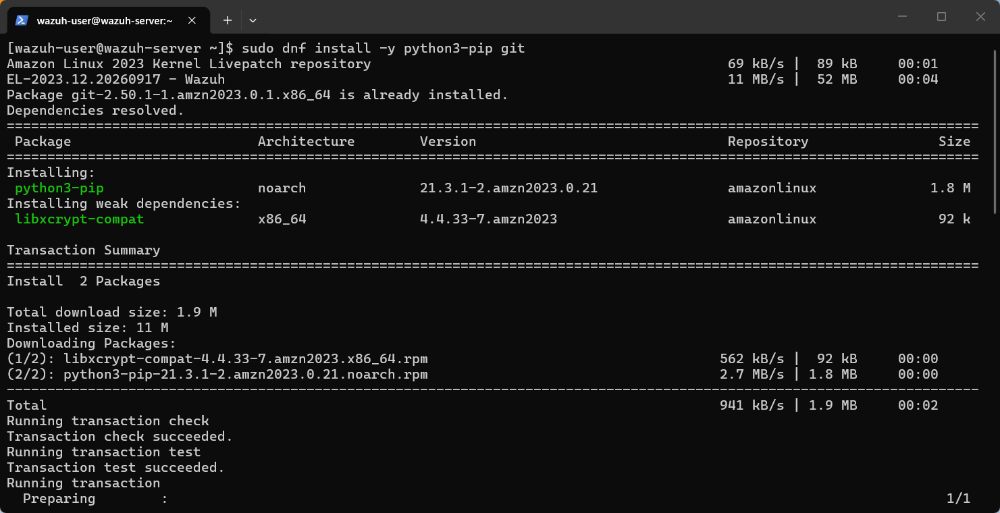
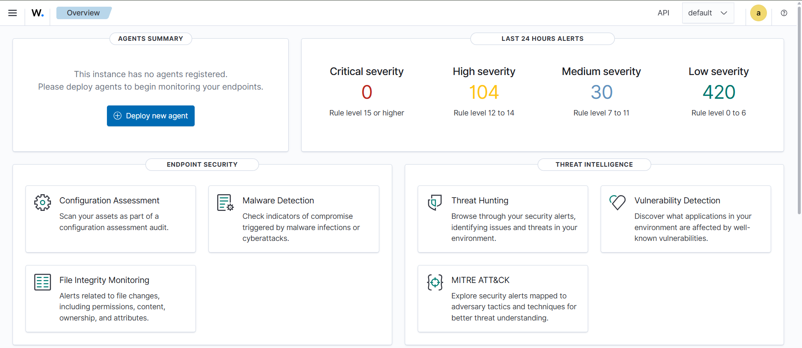

# Setting up Wazuh

The lab runs the Wazuh all-in-one stack (manager, indexer, dashboard) in a single VM, which keeps RAM use manageable on an 8 GB host. Recommended: 4 GB RAM for the VM and an Amazon Linux 2023 / Ubuntu image.

## 1. Install Wazuh

Follow the official quickstart on the VM:

```bash
curl -sO https://packages.wazuh.com/4.x/wazuh-install.sh && sudo bash ./wazuh-install.sh -a
```



Open the dashboard at `https://<vm-ip>` with the credentials printed by the installer.



## 2. Install an agent on the endpoint

Add the endpoint through **Agents -> Deploy new agent** in the dashboard and run the generated command. The agent can run on the same Windows or Linux machine you will use for Atomic Red Team.

## 3. Forward alerts to n8n

Wazuh >= 4.4.0 ships a built-in `shuffle` integration that POSTs alerts as JSON to any webhook.

1. Publish the n8n workflow so the **production** webhook exists.
2. Edit `/var/ossec/etc/ossec.conf` on the manager and add the block from [`wazuh/ossec-integration.xml`](../wazuh/ossec-integration.xml):

```xml
<integration>
  <name>shuffle</name>
  <hook_url>http://<N8N_HOST>:5678/webhook/wazuh-alert</hook_url>
  <level>7</level>
  <alert_format>json</alert_format>
</integration>
```

3. Restart the manager:

```bash
sudo systemctl restart wazuh-manager
```

4. Check delivery: `sudo tail -f /var/ossec/logs/integrations.log` and the n8n **Executions** tab.

Notes:

- Use the **production** URL (`/webhook/...`). The *test* URL (`/webhook-test/...`) only works while the editor is waiting for a test event.
- The full alert arrives under `all_fields`; **Normalize Alert** reads it from there.
- Tune volume with `<level>`, `<rule_id>` or `<group>`.
- The webhook has no authentication. Restrict access (firewall, allow-list, reverse proxy) outside a lab.

## 4. Optional: custom rules

The samples use custom rule IDs `100100` (connection to a known malicious IP) and `100110` (suspicious download URL). These are only examples; the workflow works with any rule, it just needs the standard Wazuh alert JSON.
